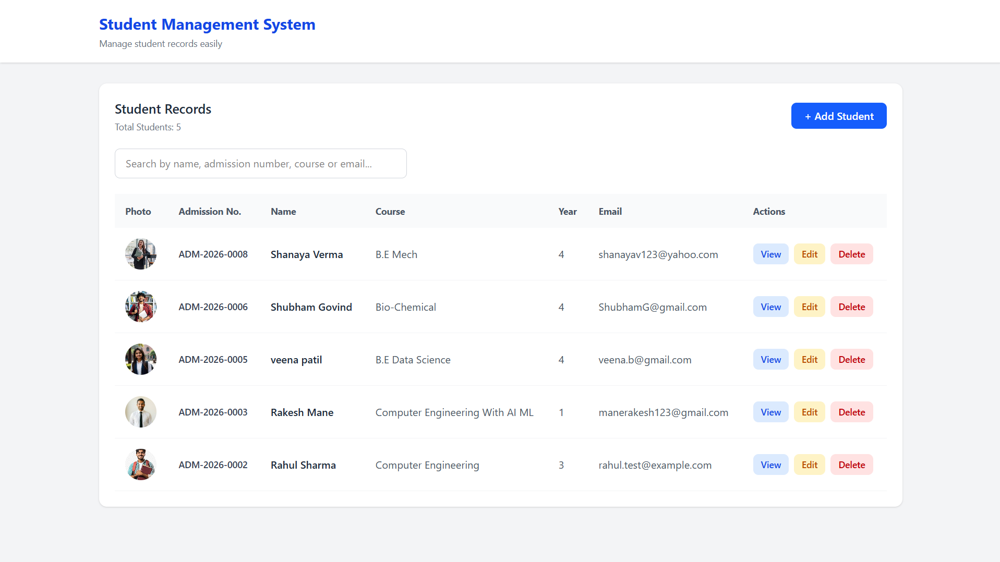
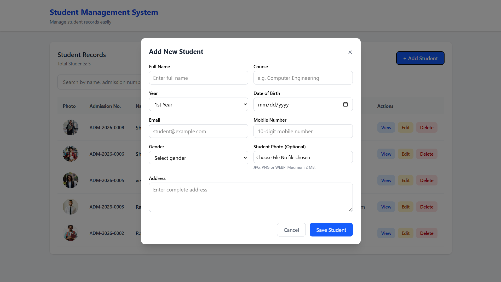
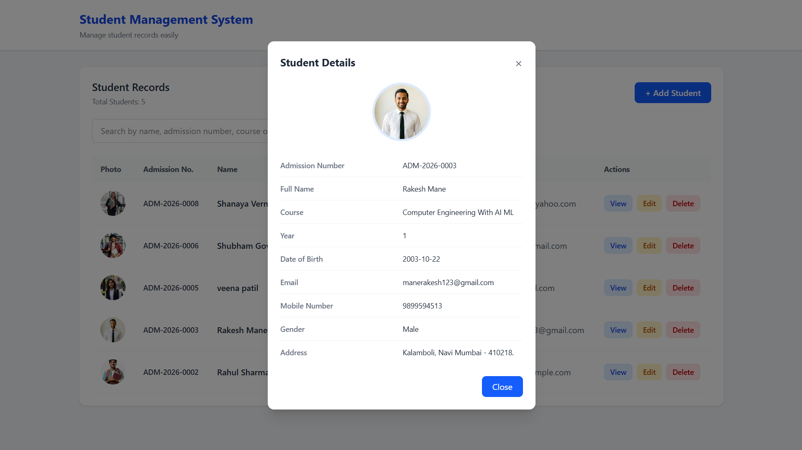
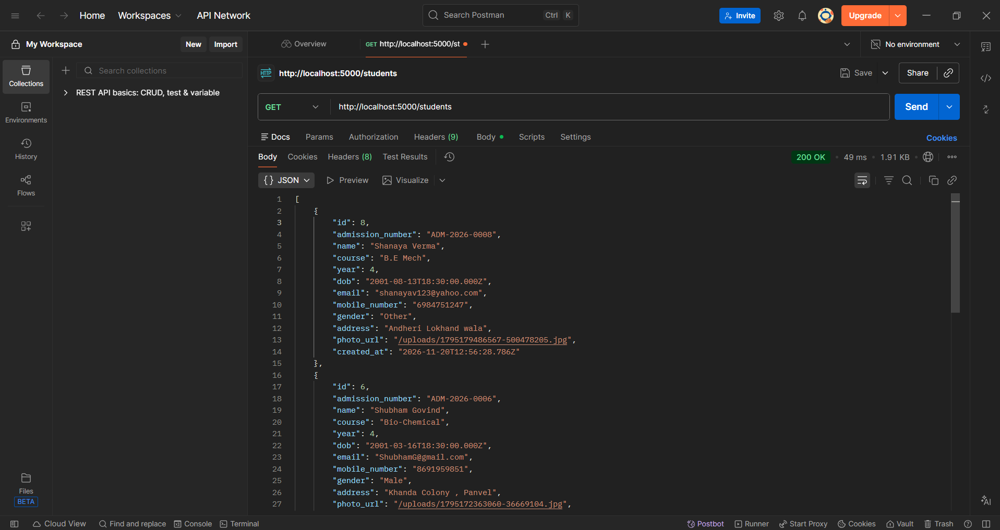
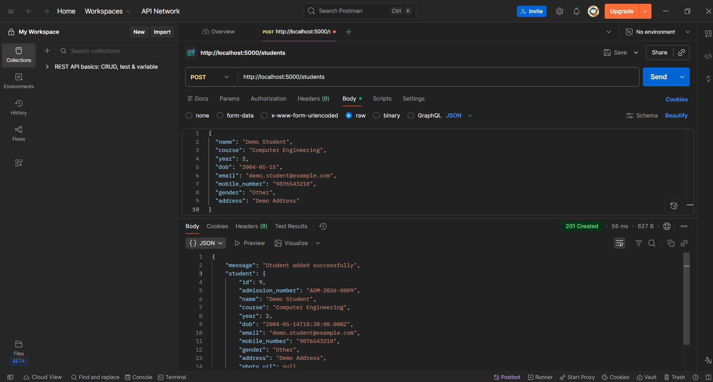

# Student Management System

A full-stack Student Management System built using **React, Node.js, Express.js, and PostgreSQL**.

The application allows users to add, view, update, search, and delete student records, including uploading student photographs. Each student receives a unique, automatically generated admission number.

## Live Demo

**Frontend:** https://student-management-system-seven-pink.vercel.app

**Backend API:** https://student-management-api-wadj.onrender.com

**GitHub Repository:** https://github.com/rakesh9892/student-management-system

> The backend is hosted on Render's free tier, so the first request may take some time after a period of inactivity.

## Technologies Used

**Frontend**
- React.js
- Vite
- Tailwind CSS
- JavaScript

**Backend**
- Node.js
- Express.js
- Multer (photo uploads)
- Cloudinary SDK

**Database**
- PostgreSQL
- Neon (cloud-hosted PostgreSQL)
- pg (Node.js PostgreSQL client)

**Deployment**
- Vercel — Frontend
- Render — Backend
- Neon — PostgreSQL database
- Cloudinary — Student photo storage

## Features

- Add new students with personal and academic information
- Automatically generate unique admission numbers
- Upload and replace student photographs
- View all students in a dashboard
- View individual student details
- Edit existing student information
- Delete student records and associated photographs
- Search students by name, admission number, course, or email
- Frontend and backend form validation
- Responsive design for desktop and mobile devices
- REST API integration
- Cloud-based database and photo storage for deployment

## Project Structure

```text
student-management-system/
│
├── backend/
│   ├── cloudinary.js
│   ├── db.js
│   ├── server.js
│   ├── upload.js
│   ├── .env.example
│   ├── package.json
│   └── package-lock.json
│
├── frontend/
│   ├── public/
│   │   ├── favicon.svg
│   │   └── icons.svg
│   ├── src/
│   │   ├── assets/
│   │   ├── components/
│   │   │   ├── StudentDetails.jsx
│   │   │   └── StudentForm.jsx
│   │   ├── api.js
│   │   ├── App.jsx
│   │   ├── index.css
│   │   └── main.jsx
│   ├── eslint.config.js
│   ├── index.html
│   ├── package.json
│   ├── package-lock.json
│   └── vite.config.js
│
├── screenshots/
│   ├── dashboard.png
│   ├── add-student.png
│   ├── student-details.png
│   ├── api-get-students.png
│   └── api-create-student.png
│
├── .gitignore
├── database.sql
└── README.md
```

## Setup Instructions

### Prerequisites

Make sure the following are installed:

- Node.js and npm
- PostgreSQL (for local database setup)
- Git

### 1. Clone the Repository

```bash
git clone https://github.com/rakesh9892/student-management-system.git
cd student-management-system
```

### 2. Set Up PostgreSQL

Create a PostgreSQL database named:

```text
student_management
```

Connect to the database using pgAdmin or psql and execute the SQL script from `database.sql`.

This creates the `students` table and the admission number sequence.

For cloud deployment, the same SQL script can be executed in a Neon PostgreSQL database.

### 3. Configure the Backend

Open a terminal:

```bash
cd backend
npm install
```

Create a `.env` file inside the `backend` directory.

**Option A — Local PostgreSQL**

```env
PORT=5000
DB_USER=postgres
DB_HOST=localhost
DB_NAME=student_management
DB_PASSWORD=your_postgresql_password
DB_PORT=5432
```

**Option B — Neon PostgreSQL**

Instead of the local database variables, configure:

```env
PORT=5000
DATABASE_URL=your_neon_postgresql_connection_string
```

**Optional — Cloudinary Photo Storage**

To store uploaded photographs in Cloudinary, add:

```env
CLOUDINARY_CLOUD_NAME=your_cloud_name
CLOUDINARY_API_KEY=your_api_key
CLOUDINARY_API_SECRET=your_api_secret
```

When Cloudinary is not configured, photographs are stored locally in `backend/uploads/`.

When Cloudinary is configured, uploaded photographs are stored in Cloudinary, and their URLs are saved in PostgreSQL.

Never commit actual passwords, database connection strings, or API secrets to GitHub.

Start the backend:

```bash
npm run dev
```

The API runs locally at:

http://localhost:5000

### 4. Configure the Frontend

Open another terminal from the project root:

```bash
cd frontend
npm install
npm run dev
```

Open the local URL shown by Vite, typically:

http://localhost:5173

By default, the frontend communicates with `http://localhost:5000`.

To connect to a deployed backend, configure the following Vite environment variable:

```env
VITE_API_URL=https://student-management-api-wadj.onrender.com
```

For Vercel deployment, set `VITE_API_URL` in the project's environment variables.

## Application Screenshots

### Student Dashboard

The dashboard displays student records, automatically generated admission numbers, search functionality, and actions to view, edit, or delete students.



### Add Student Form

Add new students with personal and academic information, including an optional photograph.



### Student Details

View complete student information, including the admission number and uploaded photograph.



## API Testing with Postman

The REST API was tested using Postman to verify student CRUD operations, request validation, and API responses.

### GET — Retrieve Students

**Endpoint:** `GET /students`

**Expected Status:** `200 OK`

Returns student records in JSON format.



### POST — Create Student

**Endpoint:** `POST /students`

**Expected Status:** `201 Created`

Creates a student record and returns the automatically generated admission number.



## REST API Endpoints

| Method | Endpoint | Description |
|---|---|---|
| GET | `/students` | Retrieve all students |
| GET | `/students/:id` | Retrieve a student by ID |
| POST | `/students` | Add a new student |
| PUT | `/students/:id` | Update student details |
| DELETE | `/students/:id` | Delete a student |
| POST | `/students/:id/photo` | Upload or replace a student photo |

### Student Fields

- `name`
- `course`
- `year`
- `dob`
- `email`
- `mobile_number`
- `gender`
- `address`

The admission number is automatically generated by PostgreSQL.

Uploaded photographs are stored locally during development or in Cloudinary when configured. The corresponding photo URL is stored in the database.

## Validation

The application includes:

- Required field validation
- Email format validation
- Ten-digit mobile number validation
- Year validation (1–4)
- Gender validation
- Date of birth validation
- Duplicate email prevention
- Photo type restrictions (JPG, PNG, WEBP)
- Maximum photo size of 2 MB

## Deployment Architecture

The deployed application uses the following architecture:

```text
User Browser
     |
     v
Vercel (React Frontend)
     |
     | REST API Requests
     v
Render (Node.js + Express Backend)
     |
     +------> Neon PostgreSQL
     |        (Student Records)
     |
     +------> Cloudinary
              (Student Photographs)
```

The frontend communicates with the backend using the `VITE_API_URL` environment variable.

The backend connects to Neon using `DATABASE_URL` and uploads photographs to Cloudinary using securely configured API credentials.

## Notes

- Environment variables and locally uploaded photos are excluded from Git version control.
- The database must be configured before starting the backend.
- The frontend and backend run as separate servers during local development.
- The deployed application uses Vercel, Render, Neon, and Cloudinary.
- Render's free instance may take additional time to respond after inactivity.
- Use fictional student information when testing or demonstrating the public application.

## Author

Developed by **Rakesh Mane**